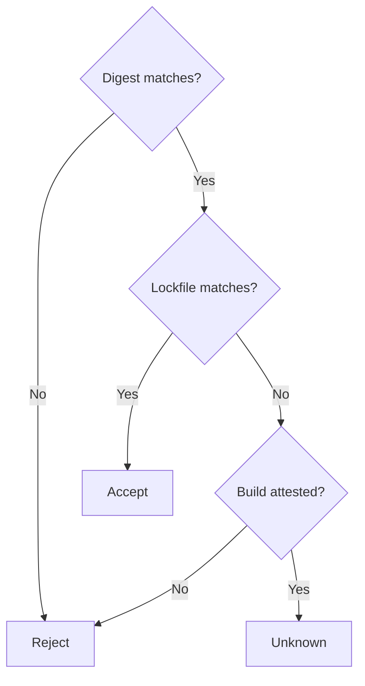

# DecisionStencil

DecisionStencil compiles documented policy decisions into an optimal binary decision tree. Validators retrieve the source notes and independently determine each recorded disposition. A calling contract can query the published tree and inspect which questions support its answer.

[Contract source](contracts/decision_stencil.py) · [Example case matrix](fixtures/cache_reuse.json) · [Direct tests](tests/direct/test_decision_stencil.py)

## What gets compiled

The synthetic example reconstructs eight documented cache-reuse dispositions with three binary features. An unresolved review remains an explicit outcome. Changing that outcome to a denial reduces the optimal depth from three questions to two.



## How it works

1. Any caller supplies the coordinate and SHA-256 digest of a commit-pinned case matrix. Every combination of its two to four Boolean features must have a case note.
2. The leader and each validator independently fetch the full notes, check the digest, and classify each recorded final disposition. The validator requires exact agreement on the normalized feature list and all case labels.
3. The compiler minimizes the number of questions in the worst case. Among trees with that depth, it minimizes internal nodes. It uses report feature order to break ties.
4. One immutable write publishes the tree, the labels, and the source commitment. A read can return the full stencil or evaluate a supplied feature vector.

The matrix must cover the complete binary feature space. Each label reflects the documented disposition for that combination under the report’s scope. Applying a stencil outside that scope requires an independent policy review.

| Method | Result |
| --- | --- |
| `publish(source, digest)` | Persist one compiled stencil and return its ID. |
| `get_stencil(stencil_id)` | Retrieve the source commitment, labels, cost, and tree. |
| `evaluate(stencil_id, bits)` | Retrieve the outcome and ordered question path for a binary input. |

## Verify locally

```sh
python -m pip install -r requirements-dev.txt
genvm-lint download --version v0.2.16
genvm-lint check contracts/decision_stencil.py
python -m pytest tests/direct -q
```

The tests compare the compiler against independent exhaustive tree search for all 337 two-feature ternary and three-feature binary decision tables. They also exercise matrix completeness, changed bytes, and validator disagreement.
